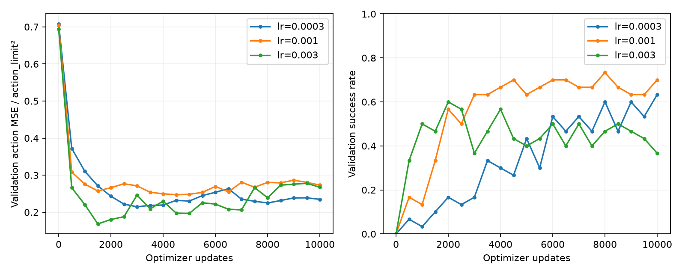

# BC：AdamW 与 10000 步训练对照

使用本地 `runs/seed42` 的同一批专家数据：200 条 train、30 条 validation，最终 ID 测试 50 个场景。所有实验使用 9D 无速度观测、6×128 SiLU 网络、batch size 256、AdamW、weight_decay=1e-4、固定学习率和 seed=42。每组完成 10000 个优化器更新步；第 1 步、每 500 步及最后一步验证，每 500 步保留完整 checkpoint，共 20 个快照。

训练使用 PyTorch 2.11.0+cpu、MuJoCo 3.3.7、CPU 单线程及 deterministic algorithms。没有使用学习率调度器。10000 步约为这批训练数据的 213 次遍历。按 validation 闭环成功率选模，相同时用 validation MSE 决胜；不使用 ID 选择学习率或 checkpoint。

| 学习率 | 最佳 step | 最佳 validation 成功率 | 该点 validation MSE | 第 10000 步成功率 |
|---|---:|---:|---:|---:|
| 0.0003 | 10000 | 19/30（63.3%） | 0.234869 | 63.3% |
| **0.001** | **8000** | **22/30（73.3%）** | 0.280578 | 70.0% |
| 0.003 | 2000 | 18/30（60.0%） | 0.180525 | 36.7% |

MSE 以 action_limit² 归一化。较低的离线 MSE 并未对应更高的闭环成功率。0.003 组后期成功率下降，中间 checkpoint 的保留有实际作用。



## 选定模型的独立 ID 测试

仅在三组训练全部完成、按 validation 选择 0.001 / step 8000 后，执行一次 ID 评测。

| 难度 | 成功数 | 成功率 |
|---|---:|---:|
| easy | 30/35 | 85.7% |
| medium | 3/10 | 30.0% |
| hard | 0/5 | 0.0% |
| 总体 | 33/50 | 66.0% |

总体 Wilson 95% 区间为 52.2%～77.6%。这只是 seed42 下三组固定学习率的比较，网络结构、batch size、权重衰减及其他 seed 尚未搜索。medium/hard 仍是明显短板。

## 复现

```bash
python scripts/sweep_bc.py --run runs/seed42 --output runs/bc-sweep-10k --lrs 0.0003 0.001 0.003 --steps 10000 --interval 500 --device cpu --threads 1
```

`sweep.json` 保存结果，`learning_curves.png` 保存曲线，各实验目录保存配置、训练历史与 checkpoint。`bc.pt` 为验证集选出的最优模型，`bc.last.pt` 为最后保存点，`checkpoints/bc.step00008000.pt` 为第 8000 步快照。完整权重和轨迹位于被 Git 忽略的 `runs` 目录中。

当前默认配置采用 AdamW、lr=0.001、weight_decay=0.0001、max_steps=8000，旧运行配置不会自动更新。本报告的三组历史对照仍为 10000 步；复用旧数据并应用当前默认训练设置：

```bash
recap migrate --run runs/seed42 --output-run runs/seed42-adamw10k --train-config configs/default.yaml
recap train --model bc --run runs/seed42-adamw10k --config runs/seed42-adamw10k/config.json
recap evaluate --model bc --run runs/seed42-adamw10k --config runs/seed42-adamw10k/config.json --splits id
```
