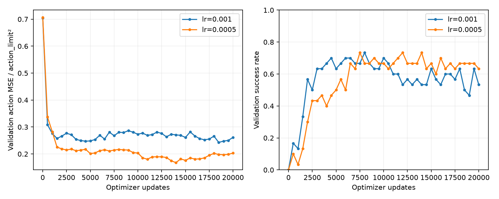

# BC：0.001 与 0.0005，20000 步上限

两组均从相同 seed=42 从头训练，各完成 20000 个优化器更新步。使用与上次实验相同的 200 条 train 专家轨迹、30 条 validation 场景、50 个 ID 场景，以及 9D 无速度观测、6×128 SiLU 网络、**batch size 256**、AdamW、weight_decay=1e-4。学习率固定，不使用调度器。

使用 PyTorch 2.11.0+cpu、MuJoCo 3.3.7、CPU 单线程和 deterministic algorithms。第 1 步及每 500 步执行验证，每组共 41 次验证、40 个完整 checkpoint。20000 步约为这批训练数据的 426 次遍历。0.001 组前 10000 步的训练与验证记录与上次实验逐点相同。

## 验证结果与选择

| 学习率 | 最佳 step | 最佳验证成功率 | 该点 validation MSE | 第 20000 步成功率 |
|---|---:|---:|---:|---:|
| 0.001 | 8000 | 22/30（73.3%） | 0.280578 | 53.3% |
| **0.0005** | **14000** | **22/30（73.3%）** | **0.167818** | 63.3% |

两组最佳验证成功率相同，按照实验前既定的规则，用较低 validation MSE 决胜，选中 0.0005 / step 14000。MSE 以 action_limit² 归一化。0.001 的最优点没有随着训练上限增加而改变；两组最终 checkpoint 均弱于各自中间最优点。



## 选定模型的 ID 评测

两组训练全部完成并按 validation 选定模型后，再评测 ID。ID 不用于选择学习率或 checkpoint。

| 难度 | 成功数 | 成功率 |
|---|---:|---:|
| easy | 30/35 | 85.7% |
| medium | 3/10 | 30.0% |
| hard | 1/5 | 20.0% |
| 总体 | 34/50 | 68.0% |

总体 Wilson 95% 区间为 54.2%～79.2%。上轮选定模型的 ID 为 33/50，本轮成功总数净增 1，差距很小；这是单 seed、小规模固定集合上的对照，不足以说明稳定优于上轮。medium 和 hard 仍然是短板。

## 复现与产物

```bash
python scripts/sweep_bc.py --run runs/seed42 --output runs/bc-sweep-20k --lrs 0.001 0.0005 --steps 20000 --interval 500 --device cpu --threads 1
```

服务器可省略 `--device cpu` 使用可用 GPU。脚本沿用源配置的 batch size，本次源配置为 256。

本地完整产物位于 `runs/experiments/bc_adamw_seed42_20k`：

- `sweep.json`：比较与选模结果。
- `learning_curves.png`：两组验证曲线。
- `2-lr0.0005/bc.pt`：按验证集选定的第 14000 步模型。
- `2-lr0.0005/checkpoints/bc.step00014000.pt`：对应完整快照。
- 每组的 `bc.last.pt`：第 20000 步状态，可与最佳模型区分。

这些完整权重、数据和运行结果在 Git 忽略的 `runs` 目录中；本报告及曲线图可随代码提交。本次 20000 步上限仅用于该对照；对照完成后按用户选择，将通用默认配置设为 AdamW、lr=0.001、max_steps=8000，batch size 仍为 256。
